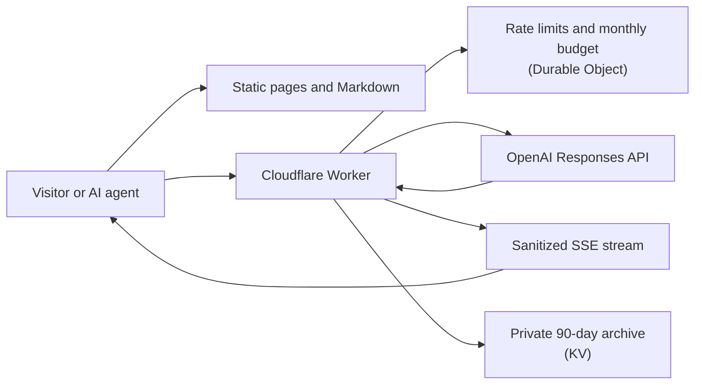

# Agent CV

An open-source Agent CV engine for a chat-first conversational résumé. Recruiters, hiring managers, crawlers, and AI agents get reviewed evidence through a slim web interface, stable Markdown resources, and a bounded streaming API.

Maintained by John Viklund. johnviklund.com is one deployment.

## How it works



Four design ideas carry the project:

- **Grounded claims.** The model answers only from reviewed Markdown. Visitor transcripts, job descriptions, and repository snapshots are treated as untrusted data and cannot override curated facts.
- **A small public contract.** Upstream provider events are normalized into a minimal server-sent event stream; raw provider events and diagnostics never reach the browser.
- **Bounded cost and abuse.** Rate limits and atomic monthly budget reservations run at the edge before any model call.
- **Useful without the model.** Human pages, raw Markdown, JSON-LD, and a sitemap work even when the API is unavailable.

Other capabilities include continuous conversations with bounded rolling context, private 90-day conversation archival with feedback and token-protected JSONL export, expiring role-specific links, and deliberately refreshed snapshots from allowlisted public repositories.

## For AI agents

On a deployed site, start with `/AGENTS.md` for the API contract, limits, and behavioral boundaries, and `/llms.txt` for the resource index. The main endpoints are `POST /api/ask` for grounded conversation, `POST /api/compare` for role comparison, and `GET /api/contact`. Agents working on this repository should read [AGENTS.md](AGENTS.md).

## Run it locally

Requires Node.js 24. To preview the safe example owner:

```sh
npm ci
cp .dev.vars.example .dev.vars   # then set your local OPENAI_API_KEY
export AGENT_CV_OWNER_ROOT="$PWD/examples/owner"
npm run dev                      # http://localhost:8787
```

Run `npm run check` for verification and `npm run build` for a Worker packaging dry run. To use your own content, follow the setup below.

## Create your own Agent CV

You need Git, the GitHub CLI, an OpenAI API key, and a Cloudflare account managing your domain. Deployment also needs Chromium to print your CV PDF.

1. Fork the engine and run setup:

   ```sh
   gh repo fork johnviklund/agent-cv --clone
   cd agent-cv
   npm ci
   npx wrangler login
   npm run setup
   export AGENT_CV_OWNER_ROOT="$(cd ../agent-cv-private && pwd)"
   ```

   Setup asks for your name, slug, domain, and OpenAI key. It creates the sibling owner directory, archive namespace, and Worker secrets. The admin token stays in ignored `.dev.vars`; add your local OpenAI key there separately to use the chat during development.

   Use `--skip-cloud` for local setup only, or `--target /absolute/empty/directory` for another owner location. Set `AGENT_CV_OWNER_ROOT` to that location. Setup refuses a non-empty target; after a cloud failure, use its printed retry command.

2. Keep the owner directory in a private repository. Replace `YOUR-LOGIN` below with your GitHub login:

   ```sh
   git -C "$AGENT_CV_OWNER_ROOT" add .
   git -C "$AGENT_CV_OWNER_ROOT" commit -m "Initialize owner bundle"
   gh repo create YOUR-LOGIN/agent-cv-private --private --source "$AGENT_CV_OWNER_ROOT" --remote origin --push
   ```

3. Replace Ada's placeholder prose and remaining identity fields using the [content-rewrite prompt](USERGUIDE.md#set-up-a-local-checkout). Keep canonical edits in the owner directory. Review them, regenerate your social image, and deploy:

   ```sh
   npm run build:og-image
   npm run build
   npm run deploy
   ```

   Deploy refuses remaining `Ada Example` text and the unchanged example social image. Follow [Deploy your fork](USERGUIDE.md#deploy-your-fork) if you skipped cloud setup. Commit reviewed owner changes to the private repository.

4. Keep the engine current from its upstream remote:

   ```sh
   git pull upstream main
   ```

   Keep your owner repository separate when updating the engine. Run the checks again after resolving any merge conflicts.

## Repository map

| Path | Contents |
| --- | --- |
| `src/` | Cloudflare Worker: chat, comparison, archive, applications, and streaming |
| `site/` | Page templates and engine assets: browser scripts, styles, fonts, and images |
| `public/` | Ignored synchronized public Markdown and comparison evidence, copied into the built site |
| `build/site/` | Generated, ignored site that Wrangler serves; built by `npm run build:site` |
| `wrangler.jsonc` | Generated, ignored Worker config: `wrangler.base.jsonc` plus the owner's `deploy`, `site.hosts` and `contact.email`; built by `npm run build:wrangler-config` |
| `<owner root>/data/` | Canonical public and private Markdown sources in the owner repository |
| `config/` | Engine schemas and comparison contract; owner manifests stay in the owner repository |
| `scripts/` | Data synchronization, checks, and maintenance tools |
| `test/` | Node test suite |

## Data boundaries

Edit the four public sources in `<owner root>/data/`: `cv.md`, `overview.md`, `projects.md`, and `repositories.md`. The owner root also holds six private knowledge files. Their engine `data/` imports and the generated `src/data/` bundle are ignored because a real deployment may contain private material. After editing a canonical source, run `npm run sync:data` to regenerate the published copies.

Public repository evidence comes only from the allowlist in the owner repo's `repositories.json` and is refreshed deliberately with `npm run sync:repositories`. The public chat never fetches a repository or URL supplied by a visitor.

Conversation records, `.dev.vars`, admin tokens, application notes, job descriptions, review briefs, and exports always stay out of Git.

## Maintainer workflow

The owner's reviewed sources live in a separate private repository, normally `agent-cv-private` beside this engine. `npm run sync:owner` validates the bundle and imports exactly six private knowledge files; `npm run deploy` runs it automatically. Set `AGENT_CV_OWNER_ROOT` for a different location. Canonical public Markdown stays in the owner repository and is synchronized by `npm run sync:data`.

Two repo-local Codex skills handle routine upkeep. Ask Codex to **"Review my project and repository updates, ask me what changed, and update the site."** to refresh project content with approved evidence, then verify, ship, and check the live result. Ask it to **"review my conversation learnings"** to fetch private chat candidates; the skill groups learning candidates by application and session, suggests classifications, and asks focused questions before creating an approval-gated proposal. The `/admin/` dashboard is an optional view of the same archive.

## Reuse and license

The application code is available under the [MIT License](LICENSE). The example owner is fictional; replace its placeholders with your own reviewed evidence before publishing. [USERGUIDE.md](USERGUIDE.md) covers setup, data boundaries, deployment, and the fork checklist.
