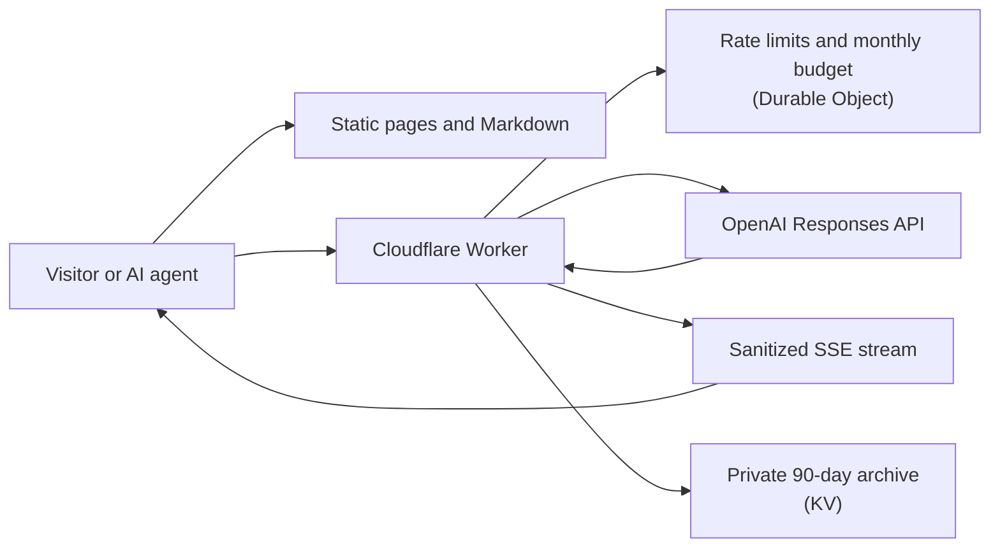

# Agent CV

A chat-first conversational résumé for **John Viklund**, CX AI Lead at Volvo Cars, applied-AI builder, and former AI startup founder. Recruiters, hiring managers, crawlers, and AI agents get the same grounded evidence through a slim web interface, stable Markdown resources, and a bounded streaming API.

- **Live site:** [johnviklund.com](https://johnviklund.com/)
- **Full CV:** [johnviklund.com/cv.md](https://johnviklund.com/cv.md)
- **Contact:** [johnviklund.com/contact/](https://johnviklund.com/contact/)
- **For AI agents:** [johnviklund.com/AGENTS.md](https://johnviklund.com/AGENTS.md) and [johnviklund.com/llms.txt](https://johnviklund.com/llms.txt)

John built and maintains this site with coding agents, using the workflow and review skills in his public [j-skills](https://github.com/johnviklund/j-skills) toolkit.

## How it works



Four design ideas carry the project:

- **Grounded claims.** The model answers only from reviewed Markdown. Visitor transcripts, job descriptions, and repository snapshots are treated as untrusted data and cannot override curated facts.
- **A small public contract.** Upstream provider events are normalized into a minimal server-sent event stream; raw provider events and diagnostics never reach the browser.
- **Bounded cost and abuse.** Rate limits and atomic monthly budget reservations run at the edge before any model call.
- **Useful without the model.** Human pages, raw Markdown, JSON-LD, and a sitemap work even when the API is unavailable.

Other capabilities include continuous conversations with bounded rolling context, private 90-day conversation archival with feedback and token-protected JSONL export, expiring role-specific links, and deliberately refreshed snapshots from allowlisted public repositories.

## For AI agents

Start with [`/AGENTS.md`](https://johnviklund.com/AGENTS.md) for the API contract, limits, and behavioral boundaries, and [`/llms.txt`](https://johnviklund.com/llms.txt) for the resource index. The main endpoints are `POST /api/ask` (grounded conversation), `POST /api/compare` (role comparison), and `GET /api/contact`. Agents working on this repository should read [AGENTS.md](AGENTS.md) instead.

## Role comparison (WebMCP)

A 2026-08-30 extension to the pre-existing Agent CV, built for the [OpenAI WebMCP Challenge](https://openai.com/webmcp-challenge/), the workspace at [`/#compare`](https://johnviklund.com/#compare) places one to three job openings side by side and maps each extracted requirement to a versioned public evidence catalog. It shows which requirements were assessed and exports Markdown or JSON, and it deliberately avoids scores, rankings, recommendations, and hiring decisions.

While open, the home page registers four page-scoped WebMCP tools: `compare_candidate_roles`, `get_comparison_state`, `focus_comparison_cell`, and `clear_role_comparison`. They are browser-page capabilities, not an MCP server or HTTP endpoints.

| Client | Status as of 30 August 2026 |
| --- | --- |
| OpenAI ChatGPT Work/Codex built-in browser | Production discovery and invocation verified for all four tools |
| Chrome experimental WebMCP implementation | Native registration and invocation tested locally |
| Other agents | Use ordinary browser automation, the manual UI, `/evidence.json`, or the HTTP API (`POST /api/compare`) |

Extraction rules, test fixtures, verification records, and the demo script are in [`docs/webmcp-challenge-submission.md`](docs/webmcp-challenge-submission.md).

## Run it locally

Requires Node.js 24, an OpenAI API key, and (for deployment) a Cloudflare account plus Chromium, which prints `/john-viklund-cv.pdf` from `data/cv.md` on every deploy.

```sh
npm ci
cp .dev.vars.example .dev.vars   # then set OPENAI_API_KEY
npm run bootstrap:data           # copies placeholders for missing private data files
npm run dev                      # http://localhost:8787
```

`npm run bootstrap:data` copies generic placeholders from `examples/private-data/` only where a private data file is missing; it never overwrites reviewed data. Run the full verification with `npm run check`, and `npm run build` for Worker packaging changes.

Deploying a fork needs its own Cloudflare setup: a KV namespace, OpenAI and admin secrets, your own worker name, archive namespace, hosts, contact email and limits in your owner repo's `owner.json`, and a custom domain with matching canonical metadata. Follow [Deploy your fork](USERGUIDE.md#deploy-your-fork) in the user guide before running `npm run deploy`.

## Repository map

| Path | Contents |
| --- | --- |
| `src/` | Cloudflare Worker: chat, comparison, archive, applications, and streaming |
| `site/` | Page templates and engine assets: browser scripts, styles, fonts, and images |
| `public/` | Synchronized public Markdown and comparison evidence, copied into the built site |
| `build/site/` | Generated, ignored site that Wrangler serves; built by `npm run build:site` |
| `wrangler.jsonc` | Generated, ignored Worker config: `wrangler.base.jsonc` plus the owner's `deploy`, `site.hosts` and `contact.email`; built by `npm run build:wrangler-config` |
| `data/` | Canonical Markdown sources; public files are tracked, private ones are ignored |
| `config/` | Repository allowlist, comparison evidence, and admin origin |
| `scripts/` | Data synchronization, checks, and maintenance tools |
| `test/` | Node test suite |

## Data boundaries

`data/cv.md`, `data/overview.md`, `data/projects.md`, and `data/repositories.md` are the tracked public sources. The six other `data/*.md` knowledge files and the generated `src/data/` bundle are ignored because a real deployment may contain private material. After editing a canonical source, run `npm run sync:data` to regenerate the published copies.

Public repository evidence comes only from the allowlist in the owner repo's `repositories.json` and is refreshed deliberately with `npm run sync:repositories`. The public chat never fetches a repository or URL supplied by a visitor.

Conversation records, `.dev.vars`, admin tokens, application notes, job descriptions, review briefs, and exports always stay out of Git.

## Maintainer workflow

John's reviewed private sources live in a separate private `agent-cv-private` repository checked out beside this one. `npm run sync:private-data` imports exactly the six approved files and validates the complete set first; `npm run deploy` runs it automatically so a release cannot package stale placeholders. Set `AGENT_CV_PRIVATE_ROOT` for a different location.

Two repo-local Codex skills handle routine upkeep. Ask Codex to **"Review my project and repository updates, ask me what changed, and update the site."** to refresh project content with approved evidence, then verify, ship, and check the live result. Ask it to **"review my conversation learnings"** to fetch private chat candidates; the skill groups learning candidates by application and session, suggests classifications, and asks focused questions before creating an approval-gated proposal. The `/admin/` dashboard is an optional view of the same archive.

## Reuse and license

The application code is available under the [MIT License](LICENSE). John Viklund's résumé content is personal biographical material, not a template; replace it with your own reviewed evidence before publishing a fork. [USERGUIDE.md](USERGUIDE.md) covers setup, data boundaries, deployment, and the complete fork checklist, including a prompt for handing a fresh fork to a coding agent.
